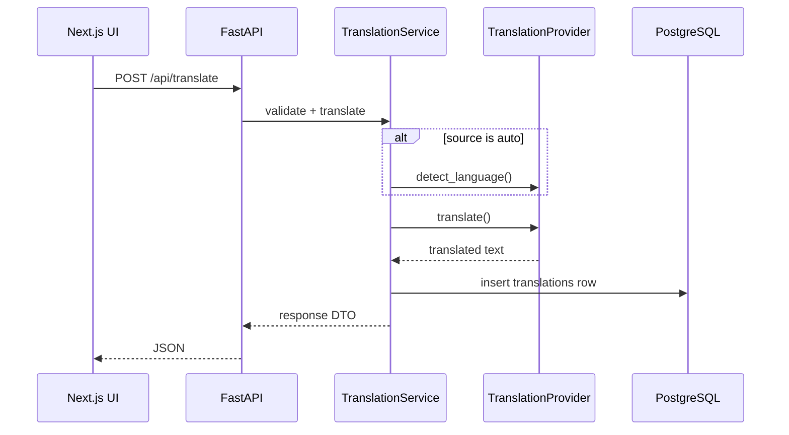

# NEXUS Translator — Architecture (Stage 1)

## Overview

NEXUS Translator is a split-stack application:

- **Frontend**: Next.js (App Router), React, TypeScript, Tailwind CSS
- **Backend**: FastAPI, Pydantic, SQLAlchemy
- **Database**: PostgreSQL
- **Shared registry**: `shared/languages.json` (single source of truth for supported languages)

## Request flow

## Provider abstraction

`TranslationProvider` defines:

- `translate(text, source, target)`
- `detect_language(text)`

Implementations:

| Provider | Env |
|----------|-----|
| `libretranslate` (default) | `TRANSLATION_API_KEY`, `TRANSLATION_API_URL` |
| `google` | `GOOGLE_APPLICATION_CREDENTIALS`, `google-cloud-translate` |

The factory selects the provider using `TRANSLATION_PROVIDER`. No provider secrets are exposed to the frontend.

## Security (Stage 1)

- CORS restricted via `CORS_ORIGINS`
- Request body size guard (~1 MB) at middleware
- SlowAPI middleware wired for rate-limit architecture (`RATE_LIMIT_PER_MINUTE` reserved for route decorators)
- SQLAlchemy ORM for parameterized queries
- `user_id` nullable on history for future authentication

## Database

Table `translations`:

- `id`, `user_id`, `source_language`, `target_language`, `original_text`, `translated_text`, `created_at`

Schema is created on backend startup (`init_db`). Alembic can be introduced in a later stage for production migrations.

## Frontend structure

- `lib/languages.ts` reads `shared/languages.json`
- `services/api.ts` calls the backend
- `components/` contains translator UI, history, theming

## Future stages (not implemented)

Speech, OCR, documents, offline mode, accounts/dashboard, and conversation mode remain out of scope for Stage 1.
